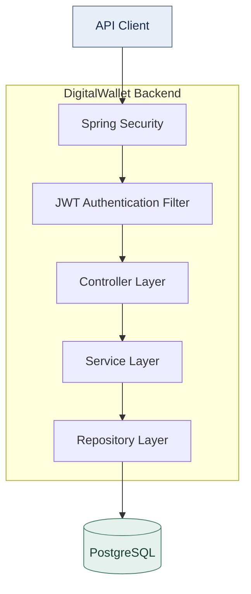
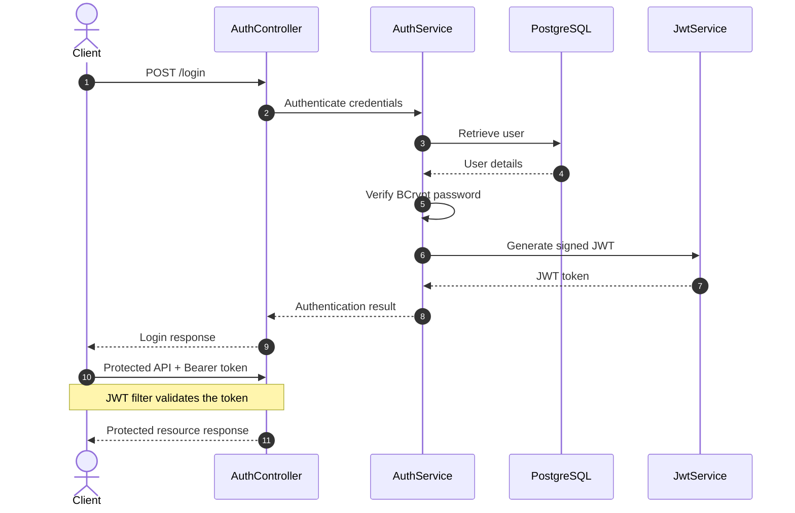
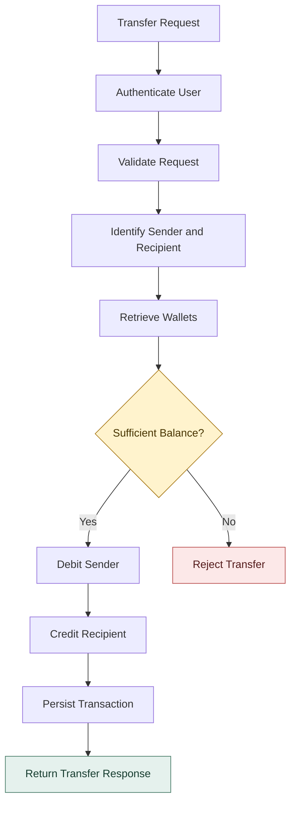
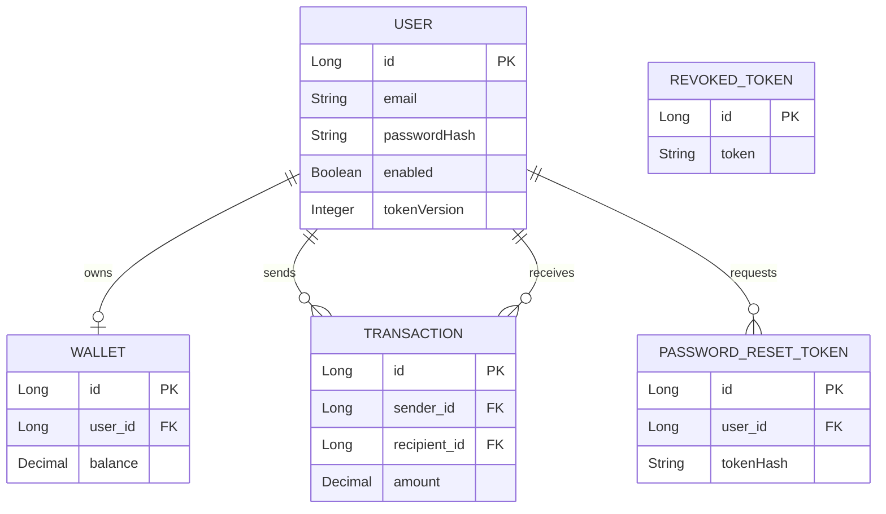

# DigitalWallet

**A Secure Digital Wallet Backend | Java · Spring Boot · PostgreSQL**

A RESTful backend application implementing secure user authentication, wallet management, user-to-user fund transfers, and transaction history.

The project demonstrates backend engineering concepts including layered architecture, JWT-based authentication, authorization, relational database persistence, transaction management, and secure password handling.

<p align="center">

  
  
  
  
  
  

</p>

---

## 1. Project Overview

DigitalWallet provides REST APIs for managing user wallets and transferring funds between registered users.

The application is designed around secure access control and reliable transaction processing. Each user can access their own wallet and transaction information, while authentication and authorization mechanisms protect sensitive operations.

### Core capabilities

| Module | Functionality |
|---|---|
| Authentication | User registration, login, JWT authentication and logout |
| User Management | User information and account handling |
| Wallet Management | Wallet creation, balance retrieval and ownership validation |
| Fund Transfer | User-to-user money transfers |
| Transaction Management | Transaction history and pagination |
| Password Management | Forgot password and secure password reset |
| API Documentation | Swagger UI and OpenAPI integration |

> **Scope:** This is a backend-only educational project. It does not integrate with real banks, payment gateways, or external financial networks.

---

## 2. Technology Stack

| Layer | Technology |
|---|---|
| Programming Language | Java 27 |
| Backend Framework | Spring Boot 4.1.2 |
| API Development | Spring Web |
| Security | Spring Security |
| Authentication | JSON Web Tokens (JWT) |
| Password Hashing | BCrypt |
| ORM | Spring Data JPA / Hibernate |
| Database | PostgreSQL |
| Input Validation | Jakarta Bean Validation |
| API Documentation | Springdoc OpenAPI / Swagger |
| Build Tool | Maven |
| Utility | Lombok |

---

## 3. System Architecture

The application follows a layered architecture to separate HTTP request handling, business logic, persistence, and security responsibilities.



### Layer responsibilities

| Layer | Responsibility |
|---|---|
| Controller | Handles HTTP requests and returns API responses |
| Service | Implements business rules and application logic |
| Repository | Performs database operations using Spring Data JPA |
| Model | Defines persistent entities |
| DTO | Separates API request and response structures |
| Security | Handles JWT authentication and endpoint authorization |
| Config | Configures application security and API documentation |
| Exception | Handles application exceptions centrally |

### Project structure

```text
src/
├── main/
│   ├── java/com/digitalwallet/digitalwallet/
│   │   ├── config/
│   │   │   ├── OpenApiConfig.java
│   │   │   └── SecurityConfig.java
│   │   │
│   │   ├── controller/
│   │   │   ├── AuthController.java
│   │   │   ├── UserController.java
│   │   │   ├── WalletController.java
│   │   │   ├── TransferController.java
│   │   │   └── TransactionController.java
│   │   │
│   │   ├── dto/
│   │   ├── exception/
│   │   ├── model/
│   │   ├── repository/
│   │   ├── security/
│   │   └── service/
│   │
│   └── resources/
│       └── application.properties/
│
└── test/
```

---

## 4. Authentication Architecture

DigitalWallet uses stateless JWT-based authentication for protected API operations.

### Authentication sequence



### Security mechanisms

- Passwords are hashed using BCrypt.
- JWT tokens are used to authenticate protected requests.
- Revoked tokens are rejected.
- Protected wallet resources are restricted to their owners.
- Password reset tokens are stored as SHA-256 hashes.
- Password reset tokens have a limited validity period and are single-use.
- Password changes invalidate previously issued JWTs through token versioning.

---

## 5. Money Transfer Workflow

The transfer module implements user-to-user fund transfers with database transaction management.

### Transfer processing



### Transaction integrity

The transfer operation uses Spring's transaction management to maintain consistency across related database changes.

Important considerations:

- Validate the transfer request before processing.
- Verify sender and recipient wallet ownership.
- Check the sender's available balance.
- Debit the sender and credit the recipient.
- Persist the corresponding transaction record.
- Roll back database changes if the operation fails.

---

## 6. Database Design

The application uses PostgreSQL as its relational database.

### Core entities

| Entity | Responsibility |
|---|---|
| User | Stores registered user information and account status |
| Wallet | Stores wallet ownership and balance |
| Transaction | Stores transfer records |
| RevokedToken | Tracks revoked authentication tokens |
| PasswordResetToken | Stores password reset token hashes and expiry information |

### Conceptual entity relationships



*Note: This is a conceptual relationship diagram, not a complete representation of every database column or constraint.*

---

## 7. API Overview

The application exposes REST endpoints for authentication, user management, wallets, transfers, and transaction history.

The following is a module-level overview. Refer to Swagger UI for the exact paths, HTTP methods, request schemas, and response formats.

| Module | Operations | Access |
|---|---|---|
| Authentication | Register, login, logout | Public / Authenticated |
| User | Retrieve user information | Authenticated |
| Wallet | Create wallet, retrieve wallet details | Authenticated |
| Transfer | Initiate money transfer | Authenticated |
| Transaction | Retrieve transaction history | Authenticated |
| Password Reset | Request reset, reset password | Public reset workflow |

### API documentation

Swagger UI is available at:

```text
http://localhost:8080/swagger-ui/index.html
```

OpenAPI specification:

```text
http://localhost:8080/v3/api-docs
```

Use Swagger UI to explore endpoints and test requests with JWT authorization.

---

## 8. Error Handling and Validation

The application uses centralized exception handling to provide consistent API error responses.

Key implementation areas:

- Request validation using Jakarta Validation.
- Centralized exception handling using `@RestControllerAdvice`.
- Appropriate HTTP status codes for application errors.
- Handling invalid credentials and missing resources.
- Validation of wallet access and transfer requests.

---

## 9. Getting Started

### Prerequisites

Install the following:

- Java 27
- PostgreSQL
- Git

### Clone the repository

```bash
git clone https://github.com/aravind20181/digitalwallet.git
cd digitalwallet
```

### Database configuration

Create a PostgreSQL database.

Configure the following environment variables before starting the application:

| Variable | Description |
|---|---|
| `DB_URL` | PostgreSQL JDBC URL |
| `DB_USERNAME` | PostgreSQL username |
| `DB_PASSWORD` | PostgreSQL password |
| `JWT_SECRET` | JWT signing secret |

Example JDBC URL:

```text
jdbc:postgresql://localhost:5432/digitalwallet
```

Use your own local database credentials and a suitably strong JWT signing secret. Never commit credentials or signing secrets to source control.

### Run the application

**Windows PowerShell**

```powershell
.\mvnw.cmd spring-boot:run
```

**Linux / macOS**

```bash
./mvnw spring-boot:run
```

After successful startup, access Swagger UI:

```text
http://localhost:8080/swagger-ui/index.html
```

---

## 10. Testing and Verification

The application has been manually tested using Postman and Swagger UI.

| Area | Verification |
|---|---|
| User authentication | Registration and login |
| JWT security | Valid, invalid, and revoked token handling |
| Authorization | Cross-user wallet access protection |
| Wallet operations | Wallet creation and retrieval |
| Money transfers | Successful transfers and rollback scenarios |
| Transaction history | Authenticated access and pagination |
| Password reset | Token hashing, expiry, and single-use validation |
| API documentation | Swagger authentication and endpoint testing |

> Testing claims should be expanded with automated test coverage as unit and integration tests are added.

---

## 11. Current Limitations

- No integration with real banks or payment gateways.
- Password reset email delivery has not yet been implemented.
- No frontend application.
- No production cloud deployment.

---

## 12. Future Enhancements

- Email service integration for password reset.
- Automated unit and integration testing.
- Docker containerization.
- CI/CD pipeline.
- Cloud deployment.
- React-based frontend.
- Improved observability and application monitoring.

---

## 13. Author

**Aravindan R.M.**

GitHub: [@aravind20181](https://github.com/aravind20181)

Repository: [DigitalWallet](https://github.com/aravind20181/digitalwallet)

---

*DigitalWallet — A backend engineering project focused on secure authentication, wallet operations, and reliable transaction processing.*
